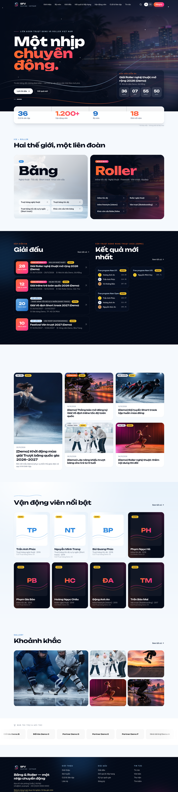
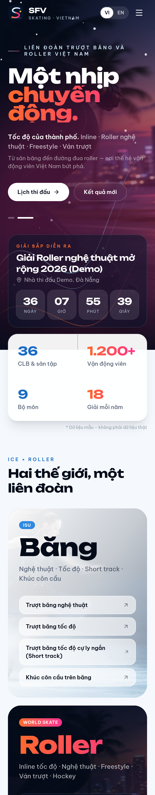
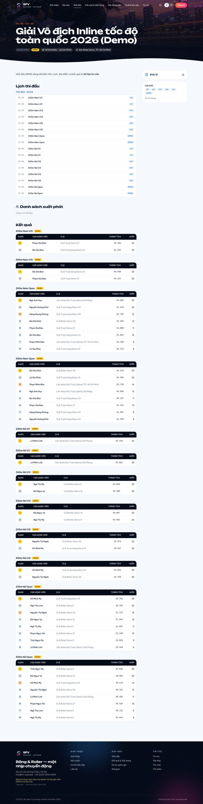
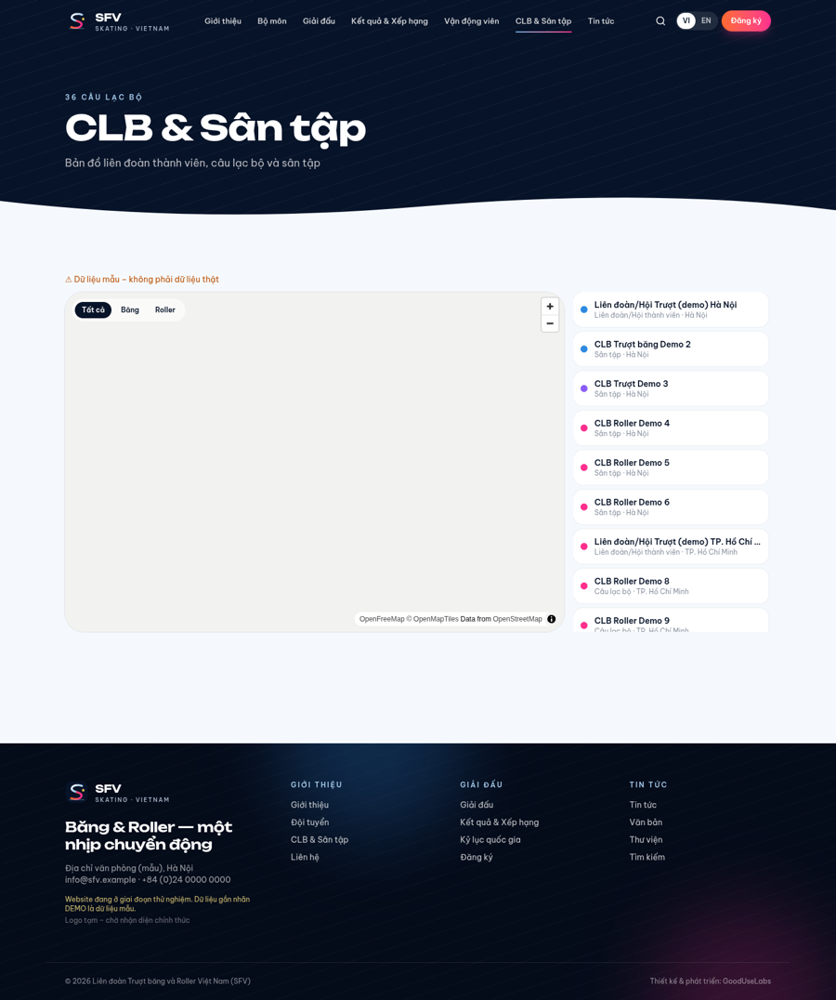

# SFV Website – Liên đoàn Trượt băng và Roller Việt Nam

Bản đầu tiên (v0.1) hệ thống website cho **SFV – Skating Federation of Vietnam**, do GoodUseLabs phát triển.
Tham chiếu cấu trúc vff.org.vn nhưng có nhận diện riêng: *băng & chuyển động* – trắng băng / xanh lạnh / navy cho mảng **Băng**, cam–hồng neon cho mảng **Roller**.

> ⚠️ **DỮ LIỆU DEMO.** Toàn bộ VĐV, kết quả, kỷ lục, CLB, ban chấp hành, nhà tài trợ, tin tức trong seed là **hư cấu** (trường `demo = true`, hiển thị nhãn “DEMO” trên web) – chỉ để kiểm thử giao diện và quy trình. Không được trình bày như dữ liệu thật. Ảnh minh họa là ảnh AI tạo. **Logo là bản tạm** chờ nhận diện chính thức. Danh sách bộ môn đang **chờ khách hàng xác nhận**.

## Tổng quan
- **Web** (`web/`): Next.js 15 App Router, TypeScript, Tailwind CSS 4, framer-motion, next-intl (VI mặc định tại `/`, EN tại `/en`), MapLibre + OpenFreeMap cho bản đồ CLB. Font Be Vietnam Pro + Unbounded.
- **CMS** (`cms/`): Directus 11.17 + PostgreSQL 17 – schema snapshot, script setup/seed, migration, extension endpoint `sfv-api` (bảng xếp hạng + import CSV/Excel).
- **Docs** (`docs/`): kiến trúc, data model, phân quyền → [docs/kien-truc.md](docs/kien-truc.md).
- **Tools** (`tools/`): script chụp màn hình bằng headless Chrome.

### Trang
Trang chủ (hero chuyển động, đếm ngược giải kế tiếp, kết quả mới nhất, tin, 2 cổng Băng/Roller, VĐV nổi bật, thư viện, nhà tài trợ, số liệu count-up) · Giới thiệu (lịch sử, BCH, các ban, thành viên) · Bộ môn (+ trang từng môn) · Giải đấu (lọc môn/trạng thái/lứa tuổi/tỉnh) + chi tiết (lịch, điều lệ, start list, bảng kết quả) · Kết quả & Xếp hạng · Kỷ lục quốc gia · VĐV + hồ sơ · Đội tuyển · CLB & bản đồ · Tin tức + chi tiết · Văn bản · Thư viện ảnh/video · Đăng ký dự giải · Liên hệ · Tìm kiếm · chuyển ngữ VI/EN.

Hiệu ứng: vệt lưỡi trượt SVG vẽ theo scroll, kính mờ (frost glass), parallax, count-up, Ken Burns; tất cả tắt khi `prefers-reduced-motion`.

## Kiến trúc
```
web (Next.js, ISR 60s) ──REST──► Directus 11 ──► PostgreSQL
                         ◄──/assets (ảnh webp)
```
Chi tiết collection & quyền: [docs/kien-truc.md](docs/kien-truc.md).

## Chạy bằng Docker Compose
```bash
cp .env.example .env        # đổi toàn bộ giá trị
docker compose up --build
# Web:   http://localhost:3000
# Admin: http://localhost:8055/admin  (ADMIN_EMAIL / ADMIN_PASSWORD trong .env)
```
Service `cms-init` tự tạo schema (REST), roles/permissions, cấu hình admin và seed demo (`SKIP_SEED=1` để bỏ seed).

## Chạy local (không Docker)
Yêu cầu: Node ≥ 22, PostgreSQL ≥ 15.
```bash
# 1. Database
sudo -u postgres psql -c "create user sfv with password 'sfv' createdb;" -c "create database sfv owner sfv;"
# 2. CMS
cd cms && cp .env.example .env   # sửa SECRET, ADMIN_PASSWORD, DB_PASSWORD, DEMO_USER_PASSWORD
npm install
npx directus bootstrap           # tạo bảng hệ thống + admin
npx directus start &             # http://localhost:8055
npm run schema:apply             # áp schema/snapshot.yaml (hoặc: npm run setup  — tạo qua REST)
node scripts/setup-roles.mjs && node scripts/admin-ux.mjs
npm run seed                     # dữ liệu DEMO
# 3. Web
cd ../web && cp .env.example .env.local && npm install
npm run dev                      # http://localhost:3000
# build/kiểm tra
npm run lint && npm run typecheck && npm run build && npm start
```

## Tài khoản quản trị
| Vai trò | Email | Mật khẩu |
|---|---|---|
| Administrator | `admin@sfv.org.vn` | `ADMIN_PASSWORD` trong `.env` |
| Editor (Biên tập tin) | `editor@sfv.org.vn` | `DEMO_USER_PASSWORD` (nếu trống, script tự sinh và in ra) |
| Competition Organizer (Ban tổ chức giải) | `organizer@sfv.org.vn` | `DEMO_USER_PASSWORD` |

Không commit mật khẩu/secret – chỉ có `.env.example`.

## Phân quyền (tóm tắt)
- **Administrator**: toàn quyền.
- **Editor**: tin tức, chuyên mục, trang, banner, thư viện, nhà tài trợ, văn bản, file.
- **Competition Organizer**: giải đấu, nội dung thi, kết quả, VĐV, CLB, kỷ lục, đội tuyển, duyệt đăng ký.
- **Public**: đọc nội dung công khai; tin hẹn giờ chỉ hiện khi tới `publish_date`; gửi đăng ký (luôn ở trạng thái `pending`).

## Nhập kết quả (CSV/Excel)
```bash
cd cms
node scripts/import-results.mjs samples/results-sample.csv            # hoặc file .xlsx
node scripts/import-results.mjs ket-qua.xlsx demo-inline-tre-2026      # slug giải nếu file không có cột competition_slug
```
Hoặc gọi trực tiếp `POST /sfv/import-results` (multipart `file`) bằng token Admin/Organizer. Cột: `competition_slug, event_code, event_name, rank, athlete_slug | athlete_name, birth_year, gender, time (mm:ss.xxx), score, age_group, points, status (OK/DNF/DNS/DSQ), notes`.
Bảng xếp hạng: `GET /sfv/rankings?discipline=<slug>&age_group=U13&gender=F` (web dùng ở `/results`).

## Đăng ký dự giải (giai đoạn 1)
Form `/register` → server action → `registrations` (status `pending`). Ban tổ chức duyệt trong Admin (đổi `approved`) → VĐV xuất hiện ở **Start list** của trang giải.

## Ảnh chụp màn hình
Thư mục `screens/` (desktop 1440px + mobile 390px, và màn hình Directus Admin). Tạo lại:
```bash
cd tools && npm install && WEB=http://localhost:3000 ADMIN_EMAIL=... ADMIN_PASSWORD=... node screenshots.mjs ../screens
```
| | |
|---|---|
|  |  |
|  |  |

## Hạn chế / việc tiếp theo
- Directus 12 (bản mới nhất) giới hạn 25 collection khi không có license → dùng **Directus 11.17.4** (bản 11 mới nhất, BSL miễn phí cho tổ chức doanh thu < 5 triệu USD). Cân nhắc license nếu nâng cấp 12.
- Hero dùng ảnh + hoạt ảnh SVG/particle; trường `site_settings.hero_video` sẵn sàng cho video slow-motion khi có footage thật.
- Chưa có: thanh toán phí, cấp thẻ VĐV, SSO, GA4, sitemap.xml, cache CDN, webhook revalidate tức thì (hiện ISR 60s).
- Bộ môn khúc côn cầu & ván trượt chờ SFV xác nhận phạm vi quản lý.
