# SFV Website – Liên đoàn Trượt băng và Roller Việt Nam

**Cổng thông tin chính thức (bản demo) cho SFV – Skating Federation of Vietnam**, phong cách cổng tin tức thể thao kiểu [vff.org.vn](https://vff.org.vn): dày tin, cập nhật nhanh, có lịch thi đấu, kết quả và bảng xếp hạng. Phát triển bởi [GoodUseLabs](https://gooduselabs.com).

> *English:* A bilingual (VI/EN) news portal + competition management system for the Vietnam Skating & Roller Federation. Next.js 15 front-end, Directus 11 headless CMS on PostgreSQL, one-command Docker deployment. Includes rankings, CSV/Excel result import and role-based editing (Admin / Editor / Competition Organizer).

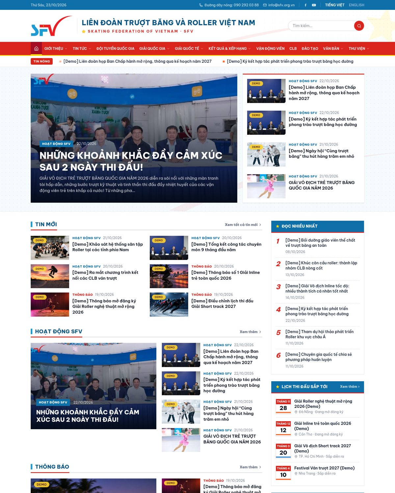

## Mục đích
Liên đoàn cần một website chính thức thay cho việc chỉ đăng tin trên Facebook: nơi công bố **tin tức, thông báo, điều lệ, lịch thi đấu, kết quả và bảng xếp hạng** của các bộ môn trượt băng & roller; đồng thời cho phép **ban biên tập và ban tổ chức giải tự cập nhật** nội dung mà không cần lập trình viên.

## Tính năng chính
- 📰 **Cổng tin kiểu VFF**: ticker tin nóng, tin nổi bật, tin mới, “Đọc nhiều nhất”, chuyên mục (Hoạt động, Thông báo, Trượt băng, Roller, Quốc tế, Đào tạo), tin hẹn giờ đăng.
- 📥 **7 bài viết thật** nhập từ trang Facebook của SFV (script `cms/scripts/import-fb.mjs`, giữ ảnh gốc).
- 🏆 **Giải đấu**: lịch, điều lệ, nội dung thi, start list, kết quả; lọc theo bộ môn / cấp độ / lứa tuổi / tỉnh.
- 📊 **Kết quả & Xếp hạng**: bảng xếp hạng theo bộ môn, lứa tuổi, giới tính; **import kết quả từ CSV/Excel**.
- 🧑‍🤝‍🧑 VĐV & hồ sơ, đội tuyển, CLB trên bản đồ (MapLibre), kỷ lục quốc gia, văn bản, thư viện ảnh/video, đăng ký dự giải.
- 🌐 **Song ngữ VI/EN** (VI tại `/`, EN tại `/en`).
- 🔐 **Phân quyền**: Administrator, Editor (biên tập tin), Competition Organizer (ban tổ chức giải).
- 🎨 Nhận diện theo **logo SFV chính thức**: xanh logo, đỏ cờ, sao vàng; favicon/app icon/OG image.
- 📱 Responsive desktop/mobile, ảnh WebP qua Directus `/assets`.
- 🐳 **Docker Compose**: Postgres + Directus + init một lần (schema, roles, seed) + web.

## Công nghệ
| Lớp | Công nghệ |
|---|---|
| Web | Next.js 15 (App Router), TypeScript, Tailwind CSS 4, next-intl, framer-motion, MapLibre |
| CMS | Directus 11.17, extension `sfv-api` (rankings + import CSV/Excel) |
| DB | PostgreSQL 17 |
| Triển khai | Docker Compose |

> ⚠️ Ngoài các bài tin thật từ Facebook và thông tin liên hệ thật, phần lớn VĐV/kết quả/CLB/nhà tài trợ là **dữ liệu DEMO** (gắn nhãn “Demo”).

## Kiến trúc
```
web (Next.js, ISR 60s) ──REST──► Directus 11 ──► PostgreSQL
                         ◄──/assets (ảnh webp)
```
Chi tiết collection & quyền: [docs/kien-truc.md](docs/kien-truc.md).

## Chạy bằng Docker Compose
```bash
cp .env.example .env        # đổi toàn bộ giá trị
docker compose up --build
# Web:   http://localhost:3000
# Admin: http://localhost:8055/admin  (ADMIN_EMAIL / ADMIN_PASSWORD trong .env)
```
Service `cms-init` tự tạo schema (REST), roles/permissions, cấu hình admin và seed demo (`SKIP_SEED=1` để bỏ seed).

## Chạy local (không Docker)
Yêu cầu: Node ≥ 22, PostgreSQL ≥ 15.
```bash
# 1. Database
sudo -u postgres psql -c "create user sfv with password 'sfv' createdb;" -c "create database sfv owner sfv;"
# 2. CMS
cd cms && cp .env.example .env   # sửa SECRET, ADMIN_PASSWORD, DB_PASSWORD, DEMO_USER_PASSWORD
npm install
npx directus bootstrap           # tạo bảng hệ thống + admin
npx directus start &             # http://localhost:8055
npm run schema:apply             # áp schema/snapshot.yaml (hoặc: npm run setup  — tạo qua REST)
node scripts/setup-roles.mjs && node scripts/admin-ux.mjs
npm run seed                     # dữ liệu DEMO
# 3. Web
cd ../web && cp .env.example .env.local && npm install
npm run dev                      # http://localhost:3000
# build/kiểm tra
npm run lint && npm run typecheck && npm run build && npm start
```

## Tài khoản quản trị
| Vai trò | Email | Mật khẩu |
|---|---|---|
| Administrator | `admin@sfv.org.vn` | `ADMIN_PASSWORD` trong `.env` |
| Editor (Biên tập tin) | `editor@sfv.org.vn` | `DEMO_USER_PASSWORD` (nếu trống, script tự sinh và in ra) |
| Competition Organizer (Ban tổ chức giải) | `organizer@sfv.org.vn` | `DEMO_USER_PASSWORD` |

Không commit mật khẩu/secret – chỉ có `.env.example`.

## Phân quyền (tóm tắt)
- **Administrator**: toàn quyền.
- **Editor**: tin tức, chuyên mục, trang, banner, thư viện, nhà tài trợ, văn bản, file.
- **Competition Organizer**: giải đấu, nội dung thi, kết quả, VĐV, CLB, kỷ lục, đội tuyển, duyệt đăng ký.
- **Public**: đọc nội dung công khai; tin hẹn giờ chỉ hiện khi tới `publish_date`; gửi đăng ký (luôn ở trạng thái `pending`).

## Nhập kết quả (CSV/Excel)
```bash
cd cms
node scripts/import-results.mjs samples/results-sample.csv            # hoặc file .xlsx
node scripts/import-results.mjs ket-qua.xlsx demo-inline-tre-2026      # slug giải nếu file không có cột competition_slug
```
Hoặc gọi trực tiếp `POST /sfv/import-results` (multipart `file`) bằng token Admin/Organizer. Cột: `competition_slug, event_code, event_name, rank, athlete_slug | athlete_name, birth_year, gender, time (mm:ss.xxx), score, age_group, points, status (OK/DNF/DNS/DSQ), notes`.
Bảng xếp hạng: `GET /sfv/rankings?discipline=<slug>&age_group=U13&gender=F` (web dùng ở `/results`).

## Đăng ký dự giải (giai đoạn 1)
Form `/register` → server action → `registrations` (status `pending`). Ban tổ chức duyệt trong Admin (đổi `approved`) → VĐV xuất hiện ở **Start list** của trang giải.

## Ảnh chụp màn hình
Bấm vào ảnh để xem trang đầy đủ (desktop 1440px, mobile 390px @2x).

| | |
|---|---|
| [](docs/screenshots/home-desktop.jpg)<br>*Trang chủ (desktop) – header logo SFV, menu đỏ, ticker tin nóng, tin nổi bật overlay, cột tin mới, “Đọc nhiều nhất”, lịch thi đấu sắp tới* | [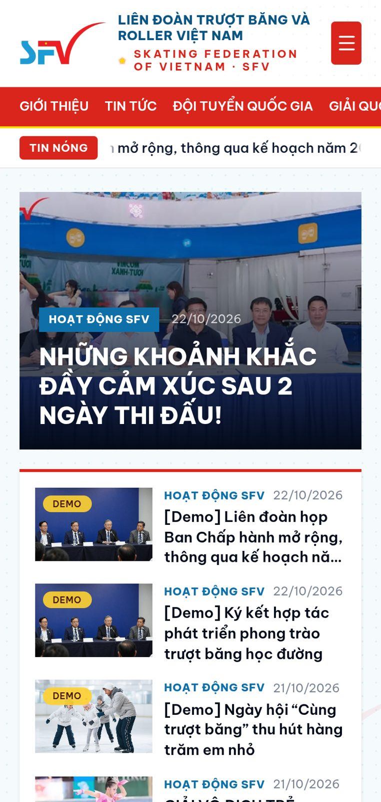](docs/screenshots/home-mobile.jpg)<br>*Trang chủ (mobile) – menu hamburger, tin dạng thẻ dọc, tối ưu màn 390px* |
| [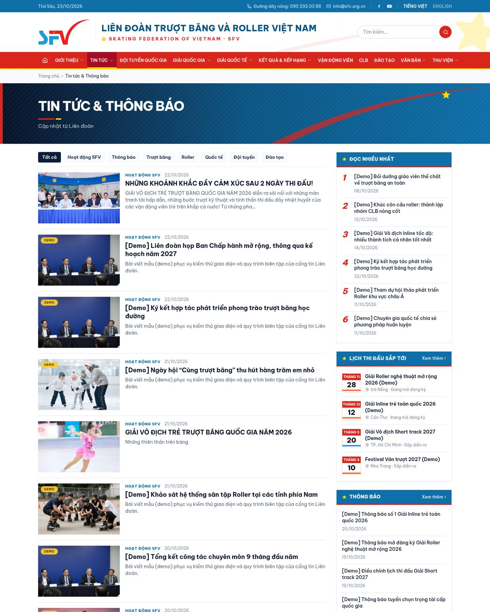](docs/screenshots/news-desktop.jpg)<br>*Tin tức & Thông báo – lọc theo chuyên mục, danh sách tin có ảnh, phân trang, sidebar widget* | [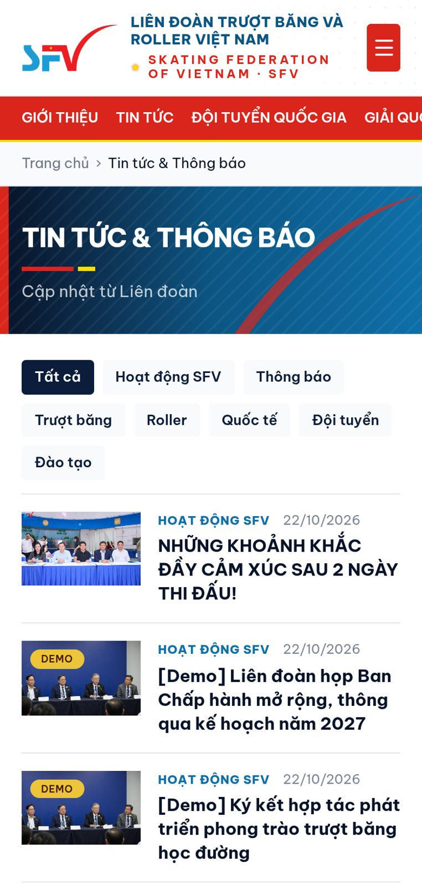](docs/screenshots/news-mobile.jpg)<br>*Danh sách tin trên điện thoại* |
| [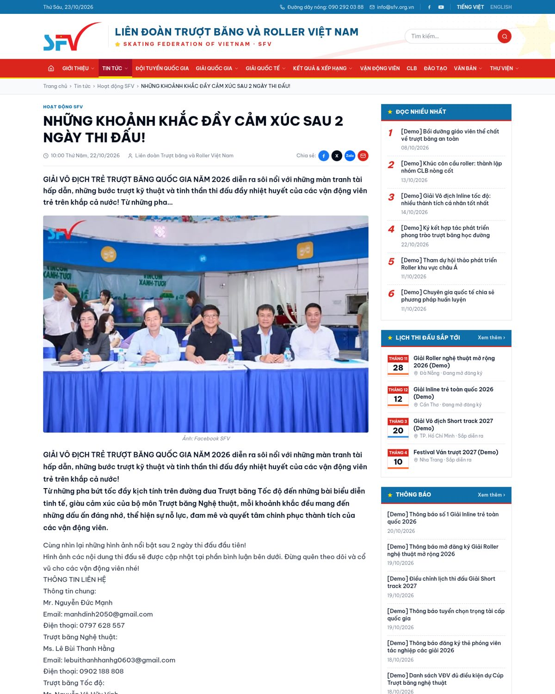](docs/screenshots/news-detail-desktop.jpg)<br>*Chi tiết tin – bài thật nhập từ Facebook SFV (ảnh, nội dung, chia sẻ), tin liên quan* | [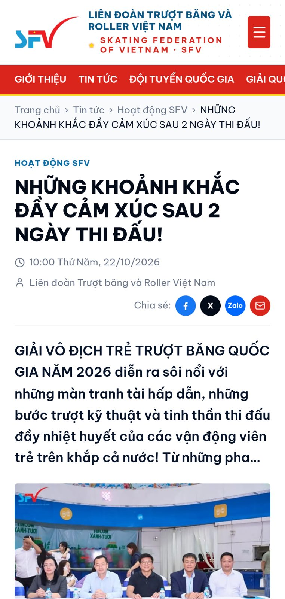](docs/screenshots/news-detail-mobile.jpg)<br>*Chi tiết tin trên mobile* |
| [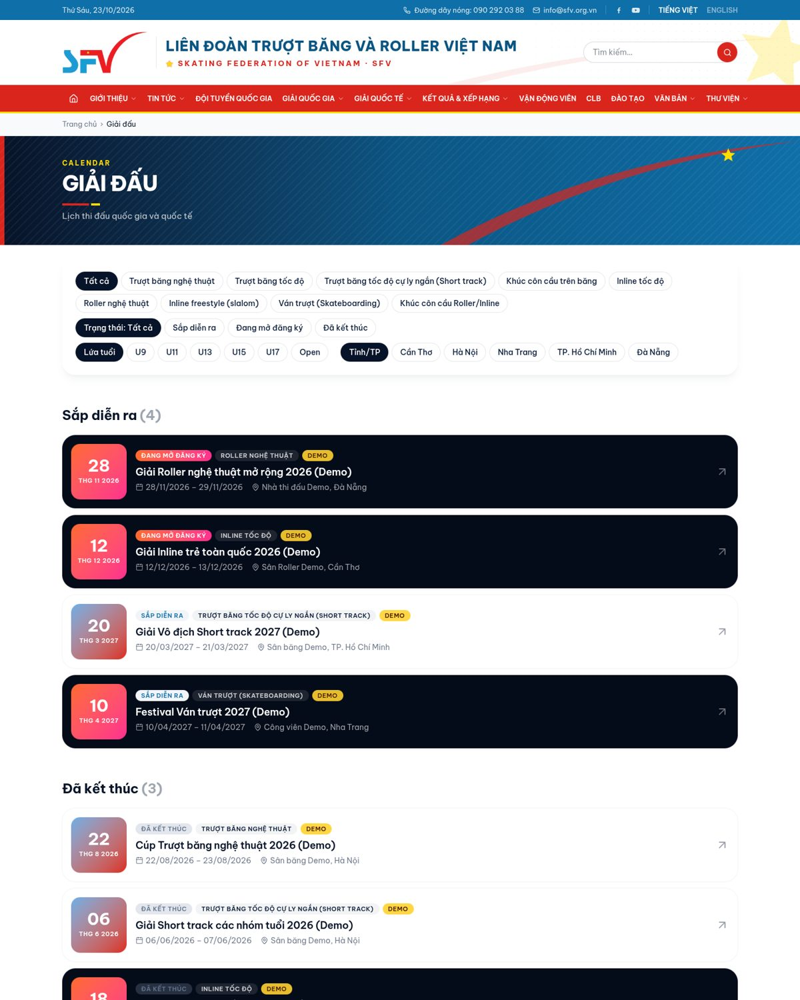](docs/screenshots/competitions-desktop.jpg)<br>*Giải đấu – lọc bộ môn/cấp độ/lứa tuổi/tỉnh, khối ngày thi đấu, sắp diễn ra / đã kết thúc* | [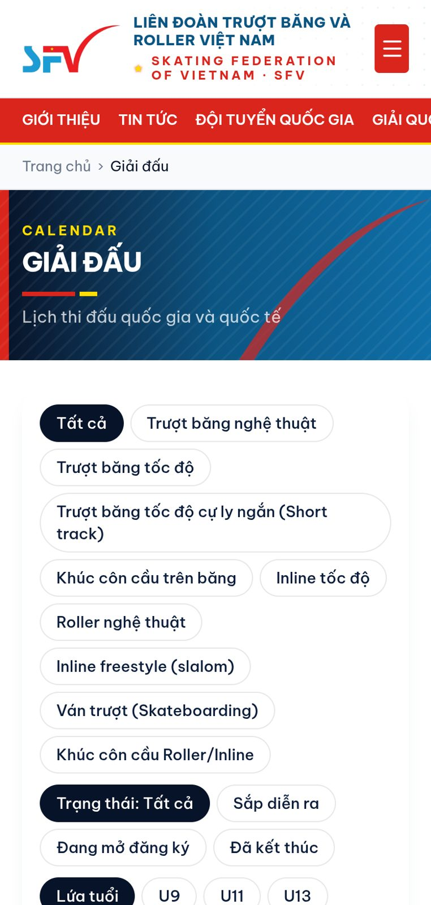](docs/screenshots/competitions-mobile.jpg)<br>*Lịch giải đấu trên mobile* |
| [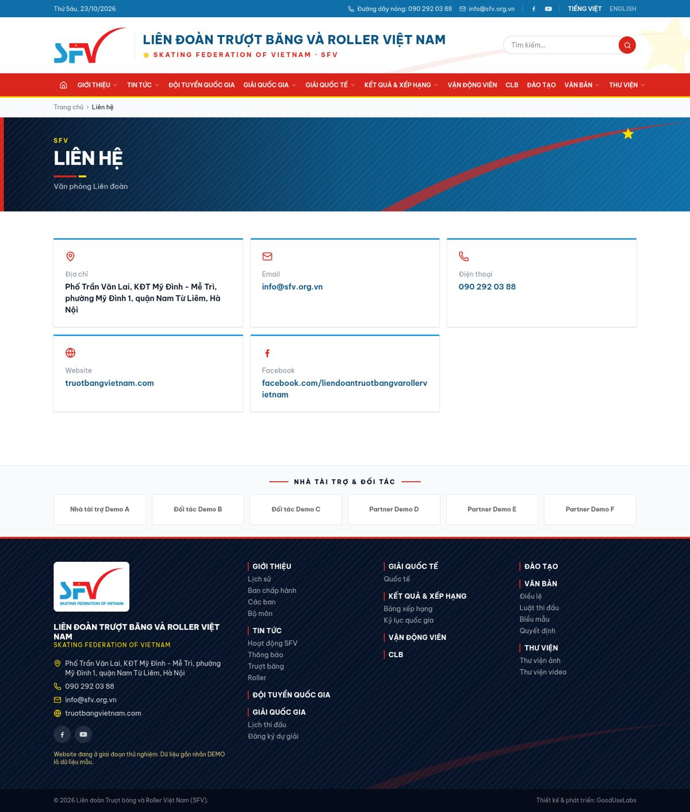](docs/screenshots/contact-desktop.jpg)<br>*Liên hệ – địa chỉ, email, hotline, website, Facebook thật của Liên đoàn; footer & đối tác* | [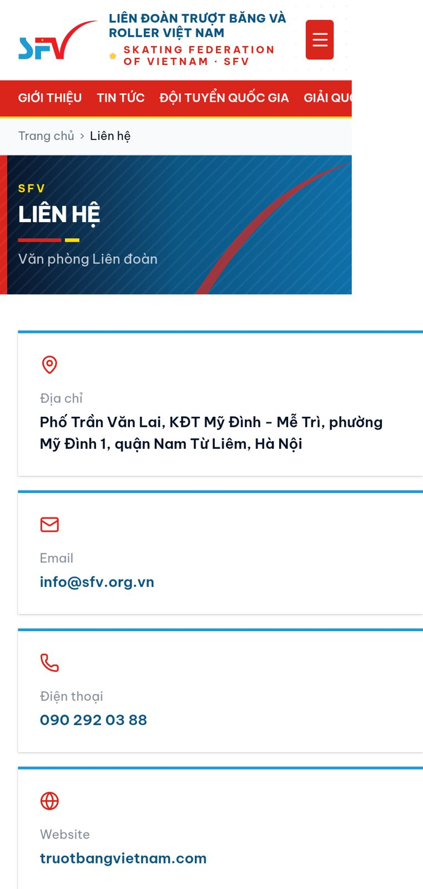](docs/screenshots/contact-mobile.jpg)<br>*Trang liên hệ trên mobile* |
| [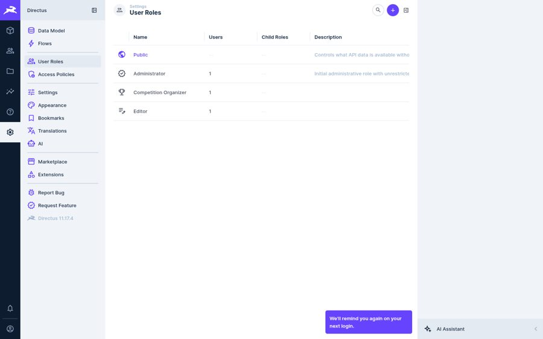](docs/screenshots/admin-roles.jpg)<br>*Directus Admin – 3 vai trò: Administrator, Editor, Competition Organizer* | [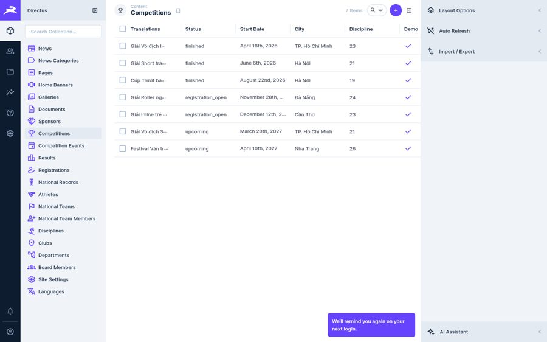](docs/screenshots/admin-competitions.jpg)<br>*Directus Admin – quản lý giải đấu, nội dung thi, kết quả* |

Tạo lại ảnh: `cd tools && npm install && WEB=http://localhost:3000 ADMIN_EMAIL=... ADMIN_PASSWORD=... node screenshots.mjs ../screens`

## Hạn chế / việc tiếp theo
- Directus 12 (bản mới nhất) giới hạn 25 collection khi không có license → dùng **Directus 11.17.4** (bản 11 mới nhất, BSL miễn phí cho tổ chức doanh thu < 5 triệu USD). Cân nhắc license nếu nâng cấp 12.
- Hero dùng ảnh + hoạt ảnh SVG/particle; trường `site_settings.hero_video` sẵn sàng cho video slow-motion khi có footage thật.
- Chưa có: thanh toán phí, cấp thẻ VĐV, SSO, GA4, sitemap.xml, cache CDN, webhook revalidate tức thì (hiện ISR 60s).
- Bộ môn khúc côn cầu & ván trượt chờ SFV xác nhận phạm vi quản lý.
